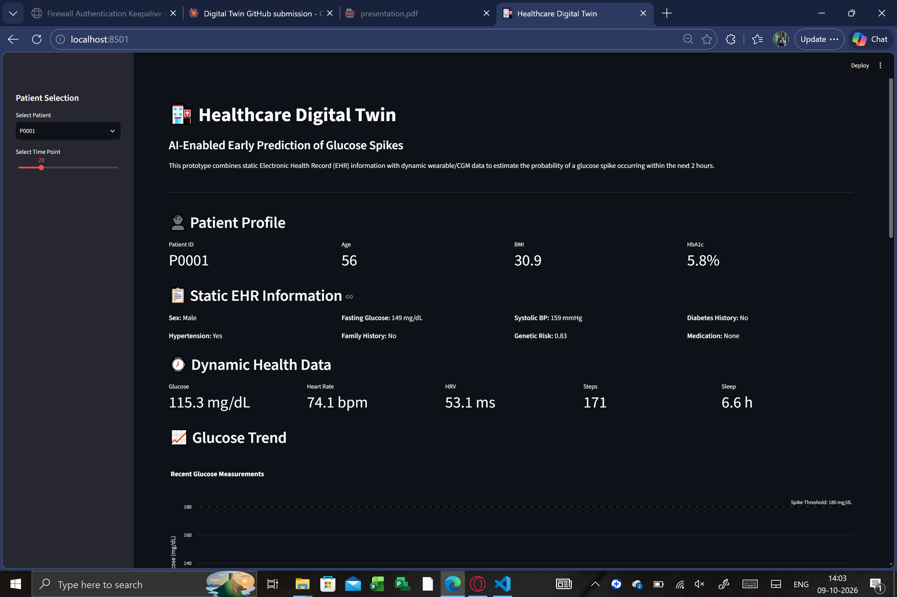
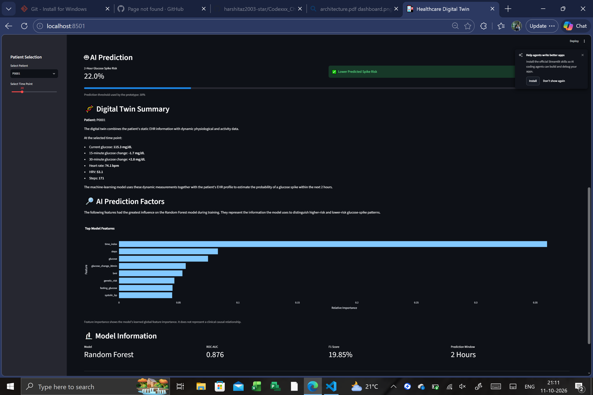
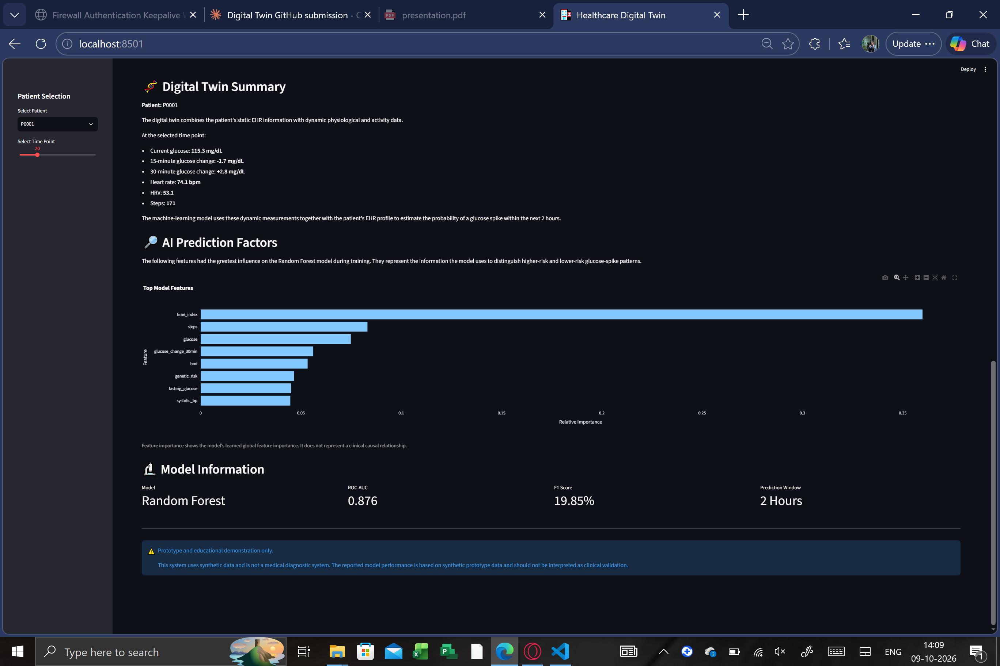

# 🏥 AI-Enabled Digital Twin for Early Prediction of Glucose Spikes

Team Codexxx | Chandigarh University**

An AI-enabled healthcare Digital Twin prototype that combines simulated Electronic Health Record (EHR) information with simulated wearable health data to estimate the probability of a glucose spike within the next 2 hours.

## Team Details

| Role | Name | Email |
|------|------|-------|
| Team Leader | Harshita Singh | 24bcs12608@cuchd.in |
| Member 2 | Drishti | 24bcs12557@cuchd.in |

- Team Name: Codexxx
- College:Chandigarh University

## Submission Links

| Item | Link |
|------|------|
| 🎥 Demo video (20+ min) | (https://www.youtube.com/watch?v=Y0pdoQWtEcE) |
| 📐 Architecture diagram | [docs/architecture.pdf](docs/architecture.pdf) |
| 📊 Presentation | [docs/presentation.pdf](docs/presentation.pdf) |
| 📄 License | [LICENSE](LICENSE) (MIT) |

## Problem Statement

Glucose levels can change over time due to meals, physical activity, and individual health conditions. Monitoring current glucose levels alone may not provide enough warning of a future spike.

This project combines patient health profiles, laboratory information, and dynamic wearable measurements to build a machine-learning prototype for early glucose-spike risk prediction.

**Healthcare use case:** early warning for patients at risk of post-meal or activity-related glucose spikes, so a doctor can intervene before the event.

## Proposed Solution

The system includes four main stages:

1. Data Generation: Create synthetic EHR and wearable datasets.
2. Data Fusion: Combine patient profiles with time-series health measurements.
3. Machine Learning:Use a Random Forest classifier to estimate the risk of a glucose spike within 2 hours.
4. Dashboard: Display patient information, glucose trends, model predictions, and feature importance using Streamlit and Plotly.

> Important: This is an educational prototype using synthetic data, not a clinically validated medical system.

## Model Performance

The final Random Forest model was evaluated on a held-out synthetic test set.

| Metric | Result |
|---|---:|
| Accuracy | 92.80% |
| Precision | 22.33% |
| Recall | 17.86% |
| F1 Score | 19.85% |
| ROC-AUC | 0.876 |

### Confusion Matrix

```text
[[16175   546]
 [  722   157]]
```

### Interpretation

- Spike events are rare in the test set (879 of 17,600 samples, about 5%), so accuracy alone is not a good measure. ROC-AUC (0.876) shows the model ranks risky samples above safe ones reasonably well.
- Precision and recall for the spike class are modest at the default 0.5 threshold. Future work includes class weighting, threshold tuning, and richer time-series features.

## Technology Stack

| Area | Tools |
|---|---|
| Language | Python |
| Data processing | Pandas, NumPy |
| Machine learning | Scikit-learn (Random Forest Classifier) |
| Visualization | Plotly, Matplotlib |
| Dashboard | Streamlit |
| Model saving | Joblib |

## Project Structure

```text
Codexxx_ChandigarhUniversity/
│
├── dashboard/
│   └── app.py
│
├── data/
│   ├── ehr.csv
│   ├── wearable.csv
│   ├── fused_dataset.csv
│   ├── generate_ehr.py
│   └── generate_wearable.py
│
├── models/
│   ├── glucose_spike_model.pkl
│   └── train_fused_model.py
│
├── src/
│   └── prepare_data.py
│
├── docs/
│   ├── architecture.pdf
│   └── presentation.pdf
│
├── LICENSE
├── requirements.txt
└── README.md
```

## How to Run

### 1. Install dependencies

```bash
python -m pip install -r requirements.txt
```

### 2. Generate synthetic data

```bash
python data/generate_ehr.py
python data/generate_wearable.py
```

### 3. Fuse the datasets

```bash
python src/prepare_data.py
```

### 4. Train the model

```bash
python models/train_fused_model.py
```

### 5. Launch the dashboard

```bash
streamlit run dashboard/app.py
```

## Dataset Description

This project uses fully synthetic healthcare data generated locally for prototype development. No real patient information is used.

### Static EHR Data

- Patient demographics, age and sex
- BMI
- HbA1c
- Fasting glucose
- Systolic blood pressure
- Diabetes history
- Hypertension history
- Family history of diabetes
- Genetic risk score
- Medication information

### Dynamic Wearable / CGM Data

- Glucose measurements
- Heart rate
- Heart rate variability (HRV)
- Steps
- Sleep duration
- Time index

### Target Variable

**`glucose_spike_2h`**: a value of `1` indicates that the simulated glucose level is expected to reach **180 mg/dL or higher within the next 2 hours**.

## System Architecture

```text
┌──────────────────────┐
│   Static EHR Data    │
│ Demographics, Labs,  │
│ History, Risk Factors│
└──────────┬───────────┘
           │
           ▼
┌──────────────────────┐
│   Dynamic Data       │
│ CGM, HR, HRV, Steps, │
│ Sleep Measurements   │
└──────────┬───────────┘
           │
           ▼
┌────────────────────────────┐
│       Data Fusion          │
│ EHR + Wearable Time-Series │
└────────────┬───────────────┘
             │
             ▼
┌────────────────────────────┐
│    Feature Engineering     │
│ Glucose Trends + Health    │
│ and Activity Features      │
└────────────┬───────────────┘
             │
             ▼
┌────────────────────────────┐
│    Random Forest Model     │
│ 2-Hour Glucose Spike Risk  │
└────────────┬───────────────┘
             │
             ▼
┌────────────────────────────┐
│      AI Prediction         │
│ Probability of Glucose     │
│ Spike within 2 Hours       │
└────────────┬───────────────┘
             │
             ▼
┌────────────────────────────┐
│    Doctor Dashboard        │
│ Streamlit + Plotly         │
└────────────────────────────┘
```

### Prediction Workflow

1. Patient EHR information provides the static health profile.
2. Wearable and CGM data provide dynamic health measurements.
3. Both datasets are joined using the patient ID.
4. Glucose trend features are calculated from the time-series data.
5. The Random Forest model processes the combined features.
6. The model estimates the probability of a glucose spike within 2 hours.
7. The Streamlit dashboard presents the patient profile, trends, prediction, and model information.

The full visual diagram is in [docs/architecture.pdf](docs/architecture.pdf).

## Dashboard Preview






## Data & Privacy

All data is synthetic and generated locally, in line with the DPDP Act and HIPAA constraints on real patient data.

## License

This project is released under the **MIT License** (see [LICENSE](LICENSE)). It is intended for educational, research, and prototype demonstration purposes.

Third-party libraries (Pandas, NumPy, Scikit-learn, Plotly, Matplotlib, Streamlit, Joblib) are used under their own open-source licenses.
